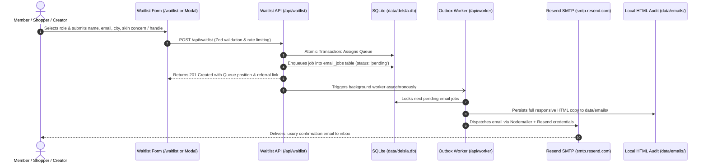

# Desla Skincare — Admin Console & Backend Architecture Guide

A comprehensive technical and operational guide for the **Desla Waitlist & Commerce Application**. This document details all backend access points, the transactional email outbox pipeline, Excel/CSV exports, custom announcement broadcasting, and step-by-step testing workflows.

---

## 1. Quick Access Points & Endpoints

| Resource | URL / Local Path | Description |
| :--- | :--- | :--- |
| **Secure Executive Console** | [`http://localhost:3000/manage.elantheadmin.waitlist`](http://localhost:3000/manage.elantheadmin.waitlist) | Password-protected executive console for Elan (telemetry, member queue, broadcasts, SMTP) |
| **Public Waitlist Page** | [`http://localhost:3000/waitlist`](http://localhost:3000/waitlist) | Dedicated standalone waitlist landing page with role-tailored forms |
| **Storefront & Modal** | [`http://localhost:3000/`](http://localhost:3000/) | Main storefront with the 3D Prism carousel and floating waitlist trigger |
| **Excel / CSV Download (API)** | [`http://localhost:3000/api/admin/export-csv`](http://localhost:3000/api/admin/export-csv) | Protected browser download of all registered members formatted for Microsoft Excel |
| **Pre-generated Local CSV** | [`data/desla_waitlist.csv`](./data/desla_waitlist.csv) | Pre-generated Excel-ready spreadsheet on your machine with all member records |
| **SQLite Database** | [`data/delsla.db`](./data/delsla.db) | WAL-mode transactional database (`waitlist` & `email_jobs` tables) |
| **HTML Email Log / Previews** | [`data/emails/`](./data/emails/) | Exact visual HTML copies of every email generated for audit & inspection |
| **Worker Outbox API** | [`POST /api/worker/process-emails`](http://localhost:3000/api/worker/process-emails) | Dispatches pending queued emails via SMTP |
| **Broadcast API** | [`POST /api/admin/broadcast`](http://localhost:3000/api/admin/broadcast) | Protected broadcast announcements to waitlist members |

---

## 2. End-to-End System Architecture

The application uses an **Enterprise Transactional Outbox Pattern**. This ensures zero lost customer registrations even during network fluctuations or email provider rate limits.



---

## 3. Database Schema Overview

The database is powered by **SQLite** located at `data/delsla.db`, configured with **Write-Ahead Logging (WAL)** and foreign keys.

### `waitlist` Table
Stores all confirmed member registrations:
- `id` (TEXT, Primary Key): Unique member ID (`usr_...`)
- `full_name` (TEXT): Member's display name
- `email` (TEXT, Indexed): Unique email address
- `city` (TEXT): Geographic region / market
- `role` (TEXT, Indexed): `shopper`, `creator`, `distributor`, or `partner`
- `skin_concern` (TEXT, Nullable): Tailored concern (for shoppers)
- `creator_handle` (TEXT, Nullable): Social handle (for creators)
- `creator_platform` (TEXT, Nullable): Instagram, TikTok, YouTube, etc.
- `distributor_business` (TEXT, Nullable): Company or clinic entity (for distributors)
- `distributor_volume` (TEXT, Nullable): Estimated monthly units
- `partner_organization` / `partner_focus` (TEXT, Nullable): Clinical details
- `queue_number` (INTEGER, Unique, Indexed): Sequential VIP priority (`#1421+`)
- `referral_code` (TEXT, Unique): Viral invitation code (`DLS-XXXXX`)
- `status` (TEXT): Reservation state (`confirmed`, `active`)
- `ip_address` / `user_agent` (TEXT): Telemetry & fraud prevention
- `created_at` (DATETIME): UTC signup timestamp

### `email_jobs` Table
Stores transactional outbox jobs:
- `id` (TEXT, Primary Key): Job identifier (`job_...` or `bcast_...`)
- `waitlist_id` (TEXT, Foreign Key): Associated member ID
- `recipient_email` (TEXT): Destination inbox
- `recipient_name` (TEXT): Recipient name
- `role` (TEXT): Audience role
- `subject` (TEXT): Subject line
- `template_type` (TEXT): `welcome_shopper`, `welcome_creator`, `welcome_distributor`, or `broadcast`
- `payload_json` (TEXT): Complete template variables
- `status` (TEXT, Indexed): `pending`, `processing`, `sent`, or `failed`
- `attempts` / `max_attempts` (INTEGER): Retry counters (max 3 attempts)
- `last_error` (TEXT, Nullable): Raw error logs from SMTP provider
- `created_at` / `sent_at` (DATETIME): Timestamp telemetry

---

## 4. Admin Dashboard Features Breakdown

Open [`http://localhost:3000/admin`](http://localhost:3000/admin) to access the console:

### 4.1 Telemetry Stats Row
- **Total Registered Members**: Real-time count of waitlist participants.
- **Pending Outbox**: Current count of queued emails awaiting dispatch.
- **Successfully Delivered**: Count of completed emails.
- **Delivery Failures**: Jobs that failed all 3 delivery attempts.

### 4.2 Resend SMTP Diagnostics & Testing Panel
- **Active Connection Badge**: Verifies TLS handshake with `smtp.resend.com:465`.
- **Step 1: Instant Resend API Key Config**: Input a new API key to update `.env.local` immediately with zero server restarts.
- **Step 2: Dispatch Live Test Email**: Send a live test message to verify delivery to your inbox.

### 4.3 Custom Broadcast Announcement Console
Send broadcast emails to your waitlist:
- **Target Audience Filter**: Choose between **All Registered Members**, **Shoppers Only**, **Creators Only**, **Distributors Only**, or **Partners Only**.
- **Category Tag**: Custom editorial header tag (e.g. `FOUNDING COHORT UPDATE`, `BATCH #1 ANNOUNCEMENT`).
- **Subject Line**: Full custom subject line.
- **Message Area**: Multi-paragraph announcement text.
- **Button Action (Optional)**: CTA button label & destination URL.
- **Dispatch Button**: Automatically personalizes and queues an individual email for each member, embedding their own Queue # and VIP Referral Code.

### 4.4 Waitlist Records Table & Deduplication
- Displays member details, role badges, profile data, and live email status.
- **Deduplication Engine**: Uses SQLite window partitioning (`ROW_NUMBER() OVER (PARTITION BY waitlist_id ORDER BY created_at DESC)`) so each member appears exactly once with their latest email status.

### 4.5 Excel & CSV Export System
- Click **"Export CSV (Excel)"** in the header or table toolbar to download `desla-waitlist-export-YYYY-MM-DD.csv`.
- Features UTF-8 Byte Order Mark (`\uFEFF`) so Microsoft Excel opens special characters, commas, and formatting cleanly without garbled text.
- A local copy is also kept at [`data/desla_waitlist.csv`](./data/desla_waitlist.csv).

---

## 5. Step-by-Step Hands-On Testing Protocol

Follow these 5 tests to verify the entire platform:

### Test 1: Test New Member Registration
1. Open [`http://localhost:3000/waitlist`](http://localhost:3000/waitlist).
2. Select the **Creator** or **Shopper** role tab.
3. Fill in:
   - **Full Name**: `Jane Doe`
   - **Email**: `jane.test@desla.com`
   - **City**: `Lagos`
   - **Details**: Select a skin concern or enter an Instagram handle.
4. Click **"Request Atelier Invitation"**.
5. **Expected Result**: A success screen displays Jane's assigned VIP Queue # (e.g. `#1431`) and referral code (`DLS-XXXXX`).
6. Refresh [`http://localhost:3000/admin`](http://localhost:3000/admin): Total count increments by 1 and Jane Doe appears at the top of the table.

### Test 2: Test the Excel / CSV Export
1. On [`http://localhost:3000/admin`](http://localhost:3000/admin), click **"Export CSV (Excel)"**.
2. Open the downloaded `.csv` file in **Microsoft Excel** or **Google Sheets**.
3. **Expected Result**: Clean spreadsheet columns displaying `Queue #`, `Full Name`, `Email Address`, `Role`, `City`, `Skin Concern / Handle`, `Referral Code`, `Referral Link`, and `Joined Date`.

### Test 3: Inspect Local HTML Email Copies
1. Open the folder [`data/emails/`](./data/emails/) in your file manager.
2. Double-click the latest `.html` file.
3. **Expected Result**: Opens in your web browser showing the full responsive luxury email layout: dark gold typography, recipient greeting, personalized queue position badge, and VIP referral card.

### Test 4: Test Sending a Live Email to Your Inbox
1. In the **Step 2: Dispatch Live Test Email** panel on `/admin`, enter your verified email: `elanwadebrook@gmail.com`.
2. Click **"Send Test"**.
3. **Expected Result**: A green banner confirms delivery, and the email arrives in your inbox.

### Test 5: Test the Broadcast Announcement Engine
1. Scroll to the **Broadcast Announcement to Waitlist** section in `/admin`.
2. Select **Creators Only** or **All Members**.
3. Enter:
   - **Category Tag**: `FIRST BATCH PREVIEW`
   - **Subject**: `Exclusive Access: Atelier Laboratory Batch #1`
   - **Message**:
     ```
     We are delighted to share that the initial formulation run of our Barrier Restorative complex is completing stability trials.

     Your VIP allocation is officially secured. Private access opens in 48 hours.
     ```
   - **Button Label**: `Preview Formulation`
   - **Button URL**: `https://delsla.com/routine`
4. Click **"Dispatch Announcement"**.
5. **Expected Result**: A banner confirms *"Successfully queued announcement to X members"*, and matching `broadcast-*.html` files are generated in `data/emails/`.

---

## 6. Going to Production: Custom Domain Email Delivery

In Resend test sandbox mode (`onboarding@resend.dev`), emails can only be delivered to your registered email address (`elanwadebrook@gmail.com`).

To send confirmation emails and broadcasts to **ANY customer email worldwide**:
1. Log in to your [Resend Dashboard](https://resend.com/domains).
2. Click **Add Domain** and enter your domain (e.g. `desla.com` or `mail.desla.com`).
3. Add the 3 DNS records provided by Resend to your domain registrar (Namecheap, GoDaddy, Cloudflare, etc.):
   - `DKIM` (TXT record)
   - `SPF` (MX / TXT record)
   - `DMARC` (TXT record)
4. Once verified (usually 2–5 minutes), update `SMTP_FROM` in [`.env.local`](./.env.local):
   ```env
   SMTP_FROM="Desla Skincare <concierge@desla.com>"
   ```
5. All transactional confirmation and broadcast emails will immediately deliver to any customer inbox worldwide.

---

## 7. Troubleshooting & Common Questions

### Why do some emails show "Failed" in the test environment?
Resend's free development sandbox prevents sending mail to third-party domains (like `example.com` or unverified customer addresses) with error `550 You can only send testing emails to your own email address`. The pipeline itself is fully functioning, and the exact email is saved in [`data/emails/`](./data/emails/) for auditing. Verifying a domain resolves this for production.

### What happens if the server or worker crashes mid-delivery?
All jobs are stored in SQLite (`data/delsla.db`). Unfinished or failed jobs remain safely in the queue and are automatically retried up to 3 times when the worker triggers or when you click **"Process Pending Queue"** in the admin header.

### Can duplicate members sign up multiple times?
No. If an email address already exists in the database, the API detects it, prevents duplicate queue inflation, and safely returns the user's existing queue position and referral code.
