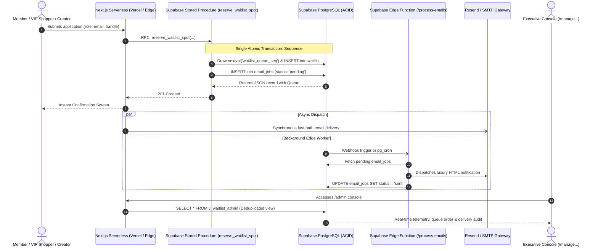

# Desla Luxury Atelier — Supabase Serverless Architecture & Deployment Guide

An enterprise-grade, serverless architecture for the **Desla Waitlist & Commerce Platform**, powered by **Supabase PostgreSQL**, **Supabase Edge Functions**, and **Next.js Serverless API routes**.

---

## 1. System Architecture Overview

Transitioning from local SQLite files to **Supabase Serverless** removes single-server bottlenecks, eliminates file lock contention (`SQLITE_BUSY`), and prevents data loss on ephemeral serverless platforms (e.g. Vercel, Netlify, AWS Lambda, Supabase Edge).



---

## 2. Serverless Architecture Components

### 2.1 Atomic VIP Queue Sequence (`waitlist_queue_seq`)
- **Problem Solved**: In SQLite or naive Node.js code, `SELECT MAX(queue_number)` under concurrent requests causes duplicate numbers or lock timeouts.
- **Supabase Solution**: A dedicated PostgreSQL sequence (`waitlist_queue_seq` starting at `#1421`) that executes non-blocking atomic increments. Thousands of simultaneous requests will each receive a unique, sequential number.

### 2.2 ACID Stored Procedure (`reserve_waitlist_spot`)
Located at [`supabase/migrations/20261026_init_desla.sql`](./supabase/migrations/20261026_init_desla.sql):
- Validates and sanitizes email input.
- Detects existing registrations: automatically updates role preferences while preserving original queue position.
- Draws sequence number atomically.
- Generates a cryptographically random, collision-tested referral code (`DLS-XXXXX`).
- Enqueues the welcome email into `email_jobs` inside the same commit.
- **Guarantees that a member record can NEVER exist without an outbox job**, preventing dropped emails.

### 2.3 Deduplicated High-Performance View (`v_waitlist_admin`)
- Uses PostgreSQL `LEFT JOIN LATERAL` with `ORDER BY created_at DESC LIMIT 1` to pair each member with their latest email delivery state.
- Powers the Executive Admin Table and Excel/CSV exports in sub-millisecond query time.

### 2.4 Row-Level Security (RLS)
Both `waitlist` and `email_jobs` have RLS enabled:
- **Public / Anon**: Can execute signup insertions and view aggregate queue counts via security definer RPC functions. Member personal information (email, phone, address) is completely shielded from public query access.
- **Service Role**: Used securely inside Next.js server-side API routes and Supabase Edge Functions with full management authority.

### 2.5 Supabase Edge Function (`supabase/functions/process-emails`)
Located at [`supabase/functions/process-emails/index.ts`](./supabase/functions/process-emails/index.ts):
- Written in TypeScript for the **Deno Supabase Edge Runtime**.
- Can be invoked directly via HTTP, triggered by a Supabase Database Webhook on `email_jobs` insert, or scheduled with `pg_cron`.
- Dispatches transactional emails via Resend HTTP API (`https://api.resend.com/emails`) or SMTP.

---

## 3. Step-by-Step Deployment Instructions

### Step 1: Create a Supabase Project
1. Log in to [Supabase](https://supabase.com).
2. Click **New Project**, choose your preferred region (e.g., Frankfurt, London, or US East), and set a database password.

### Step 2: Apply the Schema Migration
You can apply the schema in either of two ways:

#### Option A: Supabase Web Dashboard (Easiest)
1. In your Supabase Dashboard, open the **SQL Editor** from the left navigation.
2. Open [`supabase/migrations/20261026_init_desla.sql`](./supabase/migrations/20261026_init_desla.sql) in this repository.
3. Copy the entire file contents and paste them into the SQL Editor.
4. Click **Run**.
5. Both `waitlist` and `email_jobs` tables, `waitlist_queue_seq`, `v_waitlist_admin`, and stored procedures are now live.

#### Option B: Supabase CLI
```bash
npx supabase login
npx supabase link --project-ref your-project-ref
npx supabase db push
```

---

### Step 3: Configure Environment Variables
Copy the required API keys from **Project Settings -> API** in your Supabase Dashboard:

Add them to `.env.local` for local development, and add them to your cloud host (e.g. Vercel, Netlify, or Render):

```env
# Supabase Serverless Keys
NEXT_PUBLIC_SUPABASE_URL=https://your-project-ref.supabase.co
NEXT_PUBLIC_SUPABASE_ANON_KEY=eyJhbGciOiJIUzI1NiIsInR5cCI6IkpXVCJ9...
SUPABASE_SERVICE_ROLE_KEY=eyJhbGciOiJIUzI1NiIsInR5cCI6IkpXVCJ9...

# Transactional Email Gateway (Resend or SMTP)
RESEND_API_KEY=re_123456789...
SMTP_HOST=smtp.gmail.com
SMTP_PORT=465
SMTP_SECURE=true
SMTP_USER=elanwadebrook@gmail.com
SMTP_PASS=ebfdcuhrlrdggzyv
SMTP_FROM="Desla Official <elanwadebrook@gmail.com>"

# Executive Admin Password
ADMIN_PASSWORD=ElanTheAdmin2026!
```

---

### Step 4: Migrate Existing SQLite Data to Supabase
To import all existing members and outbox jobs from `data/delsla.db` into your live Supabase database without losing any queue order or referral links:

Run the automated migration script:
```bash
npm run migrate:supabase
```

The script will:
1. Connect to your Supabase project using `SUPABASE_SERVICE_ROLE_KEY`.
2. Batch-upload all existing waitlist members and outbox history.
3. Synchronize `waitlist_queue_seq` so subsequent registrations continue sequentially (e.g. starting at `#1435+`).

---

### Step 5: Deploy the Supabase Edge Function (Optional for Background Worker)
To deploy the background email processor directly to Supabase Edge infrastructure:

```bash
npx supabase functions deploy process-emails --no-verify-jwt
```

Set function secrets:
```bash
npx supabase secrets set RESEND_API_KEY=re_your_api_key SMTP_FROM="Desla Skincare <concierge@desla.com>"
```

You can now trigger the function via HTTP or attach a **Database Webhook**:
1. In Supabase Dashboard, go to **Database -> Webhooks**.
2. Click **Create Webhook**.
3. Name: `on_email_job_created`.
4. Table: `email_jobs`, Event: `INSERT`.
5. Webhook Type: **Supabase Edge Function** -> select `process-emails`.

---

### Step 6: Deploy Next.js to Vercel / Netlify
1. Push your repository to GitHub.
2. In [Vercel](https://vercel.com), click **Add New Project** and select this repository.
3. Paste the environment variables from Step 3 into the Vercel **Environment Variables** panel.
4. Click **Deploy**.

---

## 4. Verification & Testing Protocol

1. **Test Reservation**:
   - Open your deployed URL: `https://your-domain.com/waitlist`
   - Submit a test member (e.g. `VIP Collector`, `shopper` or `creator`).
   - Check the instant response: VIP Queue # and referral code are displayed.
2. **Check Supabase Table Editor**:
   - Open Supabase Dashboard -> **Table Editor** -> `waitlist`.
   - Verify the member record is created with `status = 'confirmed'`.
3. **Check Outbox & Email Delivery**:
   - In Supabase Table Editor -> `email_jobs`, verify the job is created with `status = 'sent'`.
4. **Check Executive Console**:
   - Open `https://your-domain.com/manage.elantheadmin.waitlist`
   - Enter your `ADMIN_PASSWORD`.
   - Verify real-time statistics and download the Excel/CSV export.
